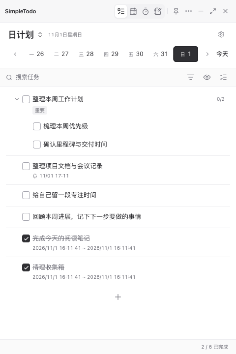
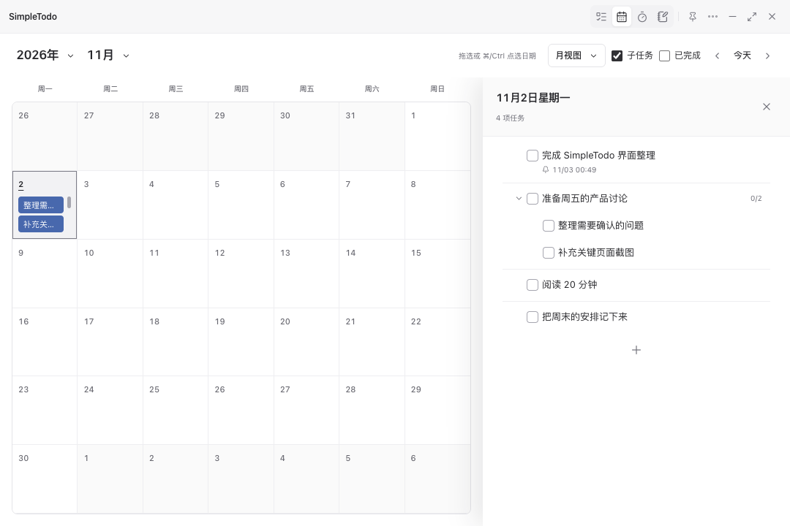

# SimpleTodo

完全本地，安静极简的桌面待办。

打开就能记，记完就能做。没有账号、云同步、AI、广告和复杂的项目体系，只有任务、日历和需要时才出现的工具。任务不上传，断网也能完整使用。

## 随手记录，专心完成

- **紧凑列表**：加号新增、单击就地编辑，Enter 连续创建同级任务；详细设置按需打开。
- **本机日程**：在日历旁只读查看本机 Outlook 日程，不混入待办、不修改原日程。macOS 需先在系统日历配置 Outlook／Exchange 账户，Windows 需使用经典 Outlook；在“设置 → 本地数据”中选择日历。
- **多级子任务**：把事情拆成步骤，逐级展开、完成；默认展开两层，逐项记住展开状态，可用眼睛按钮重置显示层级。拖动调整顺序、层级，也能把子任务拆成主任务。
- **日计划与收集箱**：按天安排，或在收集箱查看全部任务。
- **轻量提醒**：从任务旁设置时间，提醒就显示在标题下面；每天按任务范围提醒，也支持未完成自动延长结束时间。
- **月历、周历与甘特图**：拖动任务改期，停留边缘自动翻页；甘特图可拖动调整起止时间，点击日期从右侧查看和编辑任务。
- **按时间持续安排**：开始默认创建时间，结束时间可选；范围内每天独立勾选完成，也能在日历中多选日期后右键创建。
- **标签与过滤**：预置重要、紧急，支持多选、自建与排序；按标签和完成状态筛选。
- **复盘与笔记**：热力图、统计和任务报告，配合本地 Markdown 笔记回顾进展。
- **专注与倒计时**：搜索选择要专注的任务，也可自由专注；需要时打开，用完回到清单。
- **独立窗口**：列表、日历、专注、设置和复盘可同时打开，各自记住大小与位置。
- **数据自己掌握**：导入、导出、备份和恢复；自动、手动和保护备份合计保留最近 3 次。

### 清单就在手边

### 日历里安排，抽屉里处理

截图使用演示任务，展示实际应用界面。

## 下载

到 [Releases](https://github.com/junyi-deep/SimpleTodo/releases) 选择对应版本：

- **macOS · Apple Silicon**：`SimpleTodo-macos-arm64.zip`
- **Windows · 64 位**：`SimpleTodo-windows-amd64.zip`

macOS 压缩包解压后，将应用拖到“应用程序”；Windows 解压后运行应用。当前发布包未配置开发者证书签名。

默认随登录启动；可以在设置中关闭。启动及每小时自动检查新版本，提示中可选择“立即更新”或“跳过此版本”；“关于”也可手动检查、下载。检查仅访问 GitHub 发布信息，任务与笔记始终留在本机。

关闭窗口后，应用会继续驻留菜单栏或托盘；选择“退出 SimpleTodo”后完全退出。完全退出期间不会发送提醒。

## 常用操作

| 操作 | 快捷键 |
| --- | --- |
| 快速输入任务 | ⌘ / Ctrl + N |
| 保存并创建同级任务 | Enter |
| 就地编辑任务 | 单击任务标题 |
| 添加子任务 | Shift + Enter |
| 将任务提升一级 | Shift + Tab |
| 完成 / 取消完成 | Space |
| 展开、折叠和移动焦点 | 方向键 |
| 回到今天 | ⌘ / Ctrl + T |
| 关闭当前抽屉或取消操作 | Esc |

越简单，越容易坚持。
