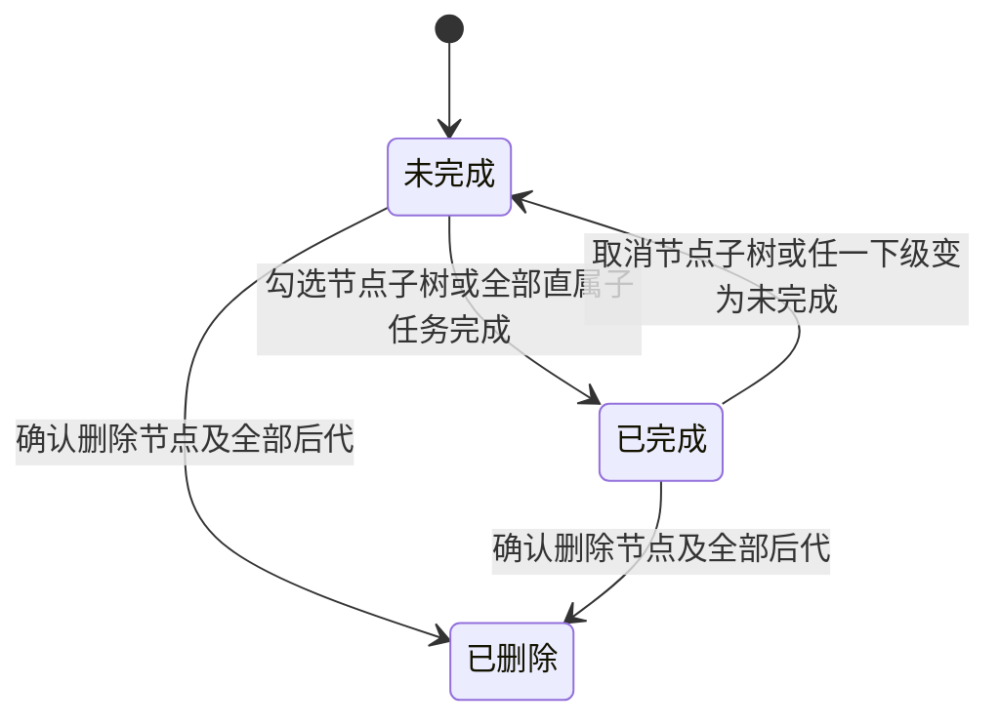
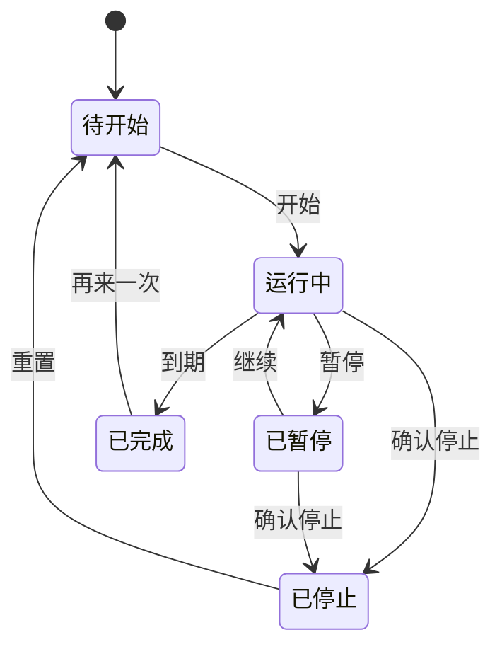

# SimpleTodo 功能设计

> 2026-10-21 更新：单窗口、黑白灰、全量收集箱、行内编辑、自定义下拉和日历右抽屉以 [界面改版](界面改版.md) 为准；下文的多窗口、颜色入口及未完成页签描述已被该方案替代。

文档日期：2026-10-20。状态：设计基线，已完成首轮实现；功能入口及验证范围见 [项目说明](../README.md)。

关联文档：[功能清单](功能清单.md)、[开发实现设计](开发实现设计.md)。本文定义 SimpleTodo 的用户可见行为，包括默认值、字段限制、层级、状态转换及异常规则；数据库和接口按这些规则实现。

## 1. 产品与交互原则

面向个人日常工作与生活安排。典型路径是“收集想法 → 安排某天 → 多级拆分 → 当天执行 → 勾选完成 → 月度回顾”。默认打开今天，收集箱承接暂时没有日期的事项，任务以树形结构组织，不建设团队或项目管理体系。

界面使用紧凑的日期导航和任务列表，围绕记录、改期、完成组织操作。重要状态不能只依靠颜色区分；鼠标拖动功能均提供菜单或按钮替代。主界面中文，技术结构保留文案集中管理能力，本轮不额外建设多语言产品界面。

macOS 使用原生红黄绿窗口按钮与 Cmd 快捷键；Windows 使用本机标题栏习惯与 Ctrl 快捷键。设置中的日期和时间按用户所处系统时区显示，采用 24 小时制；周一为一周起点。

## 2. 窗口与信息架构

| 窗口/页面 | 主要内容 | 打开方式 | 生命周期 |
| --- | --- | --- | --- |
| 主窗口 | 日期导航、日计划/收集箱/所有未完成、编辑入口、工具菜单 | 启动、菜单栏/托盘、快捷键、浮窗 | 单个实例，关闭按钮默认隐藏，进程继续运行 |
| 总览窗口 | 月历、年月选择、日期范围选择、批量工具栏 | 主窗口或菜单栏/托盘 | 单个实例，再次打开聚焦已有窗口；关闭可销毁 |
| 迷你浮窗 | 今日或所有未完成任务、折叠按钮、完成操作 | 主窗口、托盘、全局快捷键 | 单个实例，显隐独立，不承担后台调度 |
| 快速新增窗口 | 标题、日期/收集箱目标、确认 | 全局快捷键、托盘 | 单个实例；Esc 取消草稿并隐藏 |
| 专注/倒计时 | 专注计时面板、事项倒计时列表和编辑 | 工具菜单 | 首版在主窗口面板中打开，无需额外 WebView |
| 设置/关于/导入预览 | 分类配置、信息、预览校验 | 工具菜单、文件操作 | 模态对话框，一次只显示一个阻塞式对话框 |

只允许一个进程拥有当前数据目录；第二次启动唤起主窗口。主窗口全部关闭后仍有菜单栏/托盘入口；明确“退出 SimpleTodo”才停止进程。若托盘初始化失败，关闭主窗口改为退出确认，避免不可见常驻且无法找回。

### 主窗口结构（结构示意，非最终像素稿）

```text
┌──────────────────────────────────────────────┐
│ 原生窗口控制                  总览  浮窗  菜单 │
│ 2026 年 10 月          ‹      今天      ›     │
│ 周一19  周二20[选中]  周三21  周四22  ...     │
│ [日计划]   [收集箱 3]   [所有未完成 12]       │
├──────────────────────────────────────────────┤
│ 10 月 20 日 周二                  2 / 5 完成  │
│ □ 准备会议材料                    蓝色  9:30 │
│   □ 整理数据                                 │
│     □ 核对本月数据                           │
│       □ 确认统计口径                         │
│   □ 确认议程                                 │
│ □ 取快递                          重复       │
│ ☑ 提交报销                        已完成     │
│                                              │
│ + 添加待办                                   │
└──────────────────────────────────────────────┘
```

主窗口建议初始 460×720 DIP，最小 360×480；浮窗建议 300×420，最小 240×160；总览建议 1080×760，最小 840×600。以上为起始设计参数，后续通过实机可用性验证收敛。窄窗口中日期栏横向滚动，工具入口收进菜单，不压缩输入区；总览保留七列，通过内部滚动展示溢出内容。

### 外观基线（F30）

- 使用系统字体栈，正文建议 14px，说明文字 12px；中文与英文混排保持稳定行高。
- 以中性背景、细分隔线和少量强调色组织层次；浅色、深色、跟随系统三种主题。任务颜色是内容标记，不替代选中态。
- 间距以 4px 为基础，任务行至少 36px；窄行中的图标点击区域不小于 28px；键盘焦点始终可见。
- 完成任务使用复选框、划线和弱化文字共同表达；描述、子项、重复和提醒有可读图标说明。
- 主题变化只改变显示；窗口背景透明度不降低任务文字的不透明度。尊重系统“减少动态效果”；番茄钟表情动画可关闭。

## 3. 任务模型与通用规则（F02—F12）

### 3.1 根任务字段

| 字段 | 用户可见规则 |
| --- | --- |
| 标题 | 必填，去除两端空白，1—500 个 Unicode 字符；换行粘贴走导入预览，单条标题不含换行 |
| 描述 | 可选，纯文本、多行，最多 20,000 个字符；不执行 HTML，不实现富文本附件 |
| 计划日期 | 本地日历日期；空值表示收集箱，不是截止时间；支持 2000-01-01 至 2100-12-31 |
| 状态 | 未完成/已完成；完成记录包含完成时间；取消完成清除当前完成时间，不提供审计时间线 |
| 颜色 | 无、红、橙、黄、绿、蓝、紫；所有窗口和导出保持一致 |
| 排序 | 默认手动顺序；可切换颜色排序；完成项置底默认开启 |
| 子任务 | 支持多级嵌套，不设固定业务层数；每个根任务整棵树最多 200 个子任务；每个子任务有标题、状态、直属父节点和同级顺序 |
| 重复规则 | 不重复/每日/每周/每月，仅有日期的根任务可设；具体规则见第 5 节 |
| 自动延期 | 跟随全局/开启/关闭；仅非重复且有日期的任务有效 |
| 提醒 | 可关闭或指定日期时分；根任务单次仅一个有效提醒；子项不单独设提醒 |

根任务是没有父节点的日程入口；子任务可继续拥有子任务，任意节点及其全部后代组成一棵子树。所有层级都允许新增、编辑、完成、排序、删除与折叠。整棵树共同归属根任务的日期、颜色、描述、重复规则、提醒和延期设置；子任务不另设独立日程属性，不能单独拖到另一日期或收集箱。

根任务与全部层级子任务使用同一种任务节点，统一保存到 tasks 表。只有根节点没有父节点；根直属子任务的父节点就是根任务，不能把“没有独立日程字段”解释为收集箱任务。日历、收集箱和根任务数量仅统计根节点，多级树通过根节点身份继承日程属性。

子任务标题沿用根任务的必填、字符数和换行校验规则；直属父节点与同级顺序由层级操作维护，不能通过编辑标题隐式改变结构。

### 3.2 多级子任务与层级操作（F09）

- 在任意已保存节点使用 Shift+Enter 或菜单“添加子任务”，创建直属子任务并展开该分支；子任务标题中 Enter 保存后继续新增同级节点。空白草稿只取消草稿，不删除已有节点或后代。
- 同级节点可以拖动排序；菜单“缩进一级”将节点及其子树放到前一个同级节点下，“提升一级”将其放到原父节点之后，与原父节点同级。顶层子任务不能再提升为独立根任务，首个同级节点无缩进目标时禁用该操作。
- 支持在同一根任务内，通过拖动或“移动到”选择其他父节点；只能选择根任务或合法子任务，不允许以自身或任一后代为父节点。移动整棵子树，不能丢弃后代或改变其他同级节点的相对顺序；移动后重算原、新祖先链状态。
- 不直接跨根任务移动子树，也不将根任务拖为子任务；需要拆分成独立日程时先复制内容另建根任务。重复实例内的层级编辑属于“仅本次”修改，更新模板须显式选择“本次及以后”。
- 分支旁显示展开箭头、完成状态及“已完成叶节点/全部叶节点”进度，叶节点不显示折叠按钮；根任务统计仍按根任务数量计算，避免祖先和后代被重复计数。
- 默认每层缩进 16 DIP；深层结构不持续挤压标题宽度，提供“聚焦此分支”和祖先面包屑，保留完整路径。层级深度不因窗口宽度而截断，折叠状态只影响显示，不改变业务状态。

### 3.3 完成与祖先联动（F04、F09）



- 勾选任意节点：在同一事务中完成该节点及全部后代，再从其直属父节点向上逐级计算至根任务。某父节点的直属子任务全部完成时，该父节点自动完成。
- 取消任意节点完成：该节点及全部后代恢复未完成，所有祖先恢复未完成；不改变目标子树以外的兄弟分支。操作前说明其影响范围。
- 没有子任务的叶节点可独立完成；有子任务的节点状态由直属子任务汇总。部分后代完成时显示半选态，持久状态仍是未完成；点击半选态表示完成整棵子树。
- 给已完成节点新增未完成子任务，使该节点及其祖先恢复未完成。删除或移出最后一个未完成子任务后，若仍有直属子任务且全部完成，则向上汇总完成；若没有直属子任务，保留该节点操作前的完成状态，再汇总其祖先。
- 完成时间只在未完成转已完成时写入，取消完成时清除；祖先完成时间为汇总操作发生时刻，不改写已完成兄弟节点的时间。
- 完成项置底在每组同级节点内生效，移动时携带完整子树，不把所有层级打散排序；编辑或拖动期间冻结排序，提交成功后更新。

### 3.4 保存、删除与并发

标题行内编辑使用 Enter 或失焦保存，Esc 撤销当前未保存改动；详情对话框使用“保存/取消”，有改动关闭时询问保存或放弃。保存期间显示处理状态，失败保留草稿和重试入口，不展示虚假的“已保存”。

删除根任务同时删除整棵子任务树并取消待发提醒；删除任意子任务同时删除全部后代，不能留下孤立节点。普通删除和批量删除均确认，分别显示根任务数、子任务总数及重复任务范围。首版不提供回收站，完整备份用于恢复整库，不承诺逐条撤销。

重复实例中删除子任务，仅修改该次实例的对应子树并标记单次例外；只有删除根实例才使用整次跳过记录，不因删除某个分支而隐藏整个日程。

两个窗口同时修改同一根任务的任意节点时，以整棵树版本检测冲突：先保存者成功；后保存者收到“任务已在其他窗口更新”，保留本地草稿，支持查看最新内容再决定重新提交，不默默覆盖。

## 4. 日计划、收集箱与快捷录入（F01—F08、F27）

### 日期与视图

日计划显示选中日期的根任务；根任务数量不重复计算子项。收集箱只显示无日期任务，数量为未完成根任务数。“所有未完成”显示已排期与无日期的全部未完成根任务：日期升序，过去日期标记逾期，今天、未来分别分组，收集箱放最后。重复任务展示历史至今天的实例和有限生成范围内的未来实例（后台默认提前 7 天，查看更远日期会扩展），提示未来已生成至哪天，不把无限重复序列解释为有限任务总数。

“仅显示未完成”是当前列表筛选项，和跨日期的“所有未完成”模式不同。完成项即使被隐藏，仍保存在数据中，可切回查看。

跨零点时，仅在用户停留今日且没有编辑草稿、拖动或范围选择时跟随新一天。浏览历史日期时保持原选择，显示“已进入新的一天 · 回到今天”。日期变更先完成后台补偿和延期，再通知所有窗口刷新。

### 新增、排序与移动

1. 在日计划新增，默认选中日期；在收集箱新增，无日期；在“所有未完成”新增，默认今天并显示目标提示。
2. Enter 保存当前任务，焦点进入下一条草稿；空白草稿按 Enter 或 Esc 取消。不把输入法组合确认识别为保存。
3. Tab 默认在控件间导航；设置“Tab 连续录入模式”后，仅标题输入中 Tab 可保存并续建同级节点，空标题则取消。层级调整使用独立快捷键和菜单，不占用 Tab。
4. 拖动手柄调整同一日期内顺序；拖到日期栏改期；拖到收集箱取消日期并取消尚未发送的提醒，操作前提示提醒将清除。
5. 普通任务改期时保留提醒的本地时分，并改到目标日期；若落到过去，则明确要求更换提醒时间或取消提醒后再保存。
6. 重复实例禁止直接拖动改期或移入收集箱；菜单提供“复制为普通任务”，复制时不带完成状态、重复规则或已发送提醒记录。
7. 颜色排序按预设颜色顺序，无色最后；同色使用手动顺序；开启完成项置底时先分完成组再按颜色排序。颜色排序期间禁用拖动重排并说明原因。

### 快捷键约定

下表 `Mod` 在 macOS 是 Cmd，在 Windows 是 Ctrl。

| 操作 | 快捷键 | 生效上下文 |
| --- | --- | --- |
| 新建任务 | Mod+N | 当前任务列表；目标由当前视图决定 |
| 新建子任务 | Shift+Enter | 任意已保存节点的标题编辑区；先保存当前节点，再新增其直属子任务 |
| 缩进一级 / 提升一级 | Mod+] / Mod+[ | 树形列表选中子任务且非输入状态；携带完整子树移动 |
| 展开/折叠/导航 | 方向键 | 树形列表非输入状态，左右展开/折叠或前往父子节点，上下移动到可见节点 |
| 保存详情/导入 | Mod+Enter | 当前对话框 |
| 取消/关闭 | Esc | 优先取消编辑、关闭菜单/对话框，其次隐藏当前辅助窗口 |
| 编辑选中任务 | Enter | 列表选中且非输入状态 |
| 删除 | Delete/Backspace | 任务或日期范围已选中且焦点不在输入控件，弹出确认 |
| 复制/粘贴 | Mod+C / Mod+V | 总览或任务选择状态；输入框始终保留原生文本行为 |
| 回到今天 | Mod+T | 主窗口或总览，无输入焦点时 |

全局快捷键默认关闭，设置中可录入。推荐但不抢先注册 Mod+Shift+Space（快速新增）、Mod+Shift+J（主窗口显隐）、Mod+Shift+M（浮窗）。注册成功后才显示生效，遇冲突保留原值并说明。

## 5. 重复与自动延期（F10、F11）

### 5.1 重复规则

每日支持每 N 天；每周支持每 N 周与多个星期；每月支持每 N 月的指定日。N 为 1—99，开始日期必填，结束可选“不结束”或“到某日”，结束日包含当天。首版不支持农历、工作日排除和任意 RRULE 表达式。

一个系列包含模板及按计划日期独立产生的实例。每个实例复制标题、描述、颜色、完整多级子任务模板和提醒时分，所有节点重新分配 ID 并按模板父子关系建立树；完成状态初始化为未完成，实例之间独立。完成某天不会提前生成“下一次”，也不会影响其他日期；手动修改任意层级的内容、结构或完成状态，将该实例标为单次例外，后续系列编辑不覆盖这棵树。

| 操作 | 行为 |
| --- | --- |
| 编辑“仅本次” | 修改当前实例的内容、颜色、子项或提醒；不改日期与系列模板 |
| 编辑“本次及以后” | 只对今天或未来实例开放；从所选日期创建新规则版本，更新该日起未完成且未单独修改的实例，并影响后续生成 |
| 保留例外 | 已完成、已跳过、已单独修改的实例不被系列修改覆盖；预览列出保留数量 |
| 删除“仅本次” | 隐藏该次实例并保留跳过记录，后续打开相同日期不会再生成 |
| 删除“本次及以后” | 截止系列规则，移除该日起未完成实例（含单次改过的实例，确认框明确数量），保留已完成记录 |
| 停止系列 | 从指定日期停止后续生成；既有历史与已完成记录保留 |

每月 31 日遇到没有 31 日的月份，落在当月最后一天；次月仍按 31 日计算，不能逐月从 28 日漂移。首版固定采用这一策略，界面提示“当月无此日期时使用月末”。

一次性普通任务转为重复系列时，当前日期成为第一个实例，其余规则从该日期起生效；提醒转换为每次发生当天的本地时分。转为收集箱前须先复制为普通任务或停止系列，避免破坏历史归属。

### 5.2 自动延期

默认全局关闭；单条可覆盖。对开启自动延期的、日期早于今天的未完成普通任务，将计划日期直接更新为今天，保留原始计划日期用于详情显示。不逐天产生副本，也不改变完成任务、收集箱任务或重复实例。

启动、检测到本地日期变化、休眠恢复时执行同一补偿流程；多次执行结果相同。整棵子任务树随根任务移动，各层级与状态保持；延期后的任务按原日期与原顺序稳定追加到今日未完成组。

延期不自动补发旧提醒，也不重新设置已过期提醒。保留旧提醒的“已过期/因延期取消”状态，并提示用户重新设定；这一点区别于用户主动改期时的时分跟随规则。

## 6. 提醒与时间语义（F12）

计划日期是日历日期，不按 UTC 转换。提醒是精确时刻：普通任务选择本地日期时分；重复任务选择每次发生当天的提醒时分。首次使用提醒时再申请系统通知权限，拒绝后仍保存任务，在设置与提醒控件显示权限状态及系统设置指引。

任务完成、删除或提醒修改后，旧的未发送提醒失效。取消完成不会重放已经发送的提醒；若提醒尚未来到且未曾发送，可以重新挂起。用户主动重设提醒会创建新的提醒版本。

运行中到点由后台调度投递系统通知，点击后定位主窗口中的任务；权限拒绝或通知调用失败时提供应用内提醒列表。系统勿扰可能抑制弹窗，应用只记录“已提交系统”，不声称用户已经看到。

休眠恢复或重启时，过去 24 小时内到期且未处理的提醒合并为一条“错过 N 条提醒”；更早的标记已过期，可在列表查看，不逐条补发。系统时钟回拨不会让相同提醒再次发送。

**完全退出应用后不承诺准时提醒，也不安装独立后台服务。** 主窗口隐藏时进程仍运行，正常调度。设置和退出确认中明确解释区别；退出时若有正在运行的专注或即将到期提醒，提供“留在后台/仍然退出”。

时区改变时：已确定的普通任务提醒、事项倒计时当前目标时刻保持原 UTC 时刻；重复倒计时从下个新周期起按新时区推算。重复任务在新系统时区按原本地时分重新安排尚未发送的未来提醒。遇夏令时缺失的本地时分，顺延到该日第一个有效时刻；重叠时分取第一次。界面显示当前时区，并在变化后提示已重新安排的数量。

## 7. 月度总览与批量操作（F13—F15）

月历以周一为首列，显示相邻月份补齐的日期但弱化；点击日期查看当天列表，点击任务打开描述与编辑入口。单元格显示前几条任务及“还有 N 条”，不把长任务挤出网格。

点击选中一天，Shift+点击选中连续范围，拖过日期可选范围；不支持离散多段范围。选择范围后出现批量工具栏；状态数量只计算根任务。勾选具体任务进入任务选择模式时，替换日期范围选择，二者不同时叠加，避免误删。

批量完成/恢复影响选中范围内的根任务及全部层级后代；若列表中同时选择祖先与后代，先按子树去重，同一节点只操作一次。重复实例按本次处理，不修改系列；批量删除同样只删除当前实例并保留跳过记录。空范围禁用操作；危险操作列出根任务数、后代总数、日期范围以及重复实例数量。

总览复制生成“源日期 + 根任务 + 完整子任务树”的本项目结构，并同时提供可读文本。粘贴以目标范围开始日对齐源范围开始日，保持任务相对日偏移；目标选区只决定锚点，不把任务复制到选区每一天。预览显示实际落入日期（含目标选区以外），确认后新增普通未完成任务，为所有节点重建 ID 与父引用，保留层级、同级顺序、文本和颜色，清除重复、提醒与所有层级完成状态。

从外部粘贴的纯文本按每行一条任务进入预览，统一落在锚点日；日历没有选中日期时禁用粘贴并提示先选日期。快捷键不会覆盖文本编辑器中的复制和粘贴。

节假日仅使用随安装包或用户手动导入的本地数据，注明覆盖年份与来源版本。没有数据的年份只显示周末，不推断法定假日或调休，不在线请求。

## 8. 迷你浮窗与窗口增强（F16—F18）

默认只显示今天未完成任务；设置可切换“今天全部”“所有未完成”，保持与主窗口相同的筛选含义。任务可勾选完成，描述与复杂编辑回到主窗口。长标题换行，子任务树默认折叠；展开后按完整层级显示，并可聚焦深层分支，勾选遵循相同的子树及祖先联动规则；任务过多使用内部滚动。

浮窗默认置顶。可切换普通窗口、置顶、桌面模式（三者互斥）；“桌面模式”指尽量处于普通应用窗口下方且位于桌面背景之上，不保证成为系统桌面组件。支持情况由平台能力检测决定，失败时恢复普通模式并提示，不能把“取消置顶”冒充“置底”。总览也可设置桌面模式和背景透明度。

背景不透明度范围 40%—100%，默认 100%；文字与交互控件保持不透明。整体原生透明效果以平台验证为准，首版至少提供清晰的背景透明方案。

拖动仅通过空白标题区域，避免与选择文本和勾选冲突。双击空白或标题区唤起主窗口；任务复选框不触发双击打开。折叠仅保留标题条，不停止通知和计时。

贴边隐藏默认关闭。启用后靠近当前显示器工作区边缘 12 DIP 内吸附，收起时保留 6 DIP 把手；悬停约 200ms 展开，移出约 800ms 收起。输入、菜单打开、拖动期间不收起。多屏用显示器工作区计算；显示器拔出后移回主屏可见区域，菜单栏/托盘提供“重置窗口位置”。

## 9. 专注与事项倒计时（F19、F20）

### 9.1 番茄时钟

首版提供单段专注，不额外扩展成统计平台。默认 25 分钟，可设 1—180 分钟，可关联一个普通或重复任务实例，也可独立专注；同一时刻最多一个专注会话。



暂停冻结剩余时长，继续产生新结束时刻；停止需确认并记录状态。完成关联任务不自动结束专注，专注结束也不自动完成任务。再次开始新会话时如已有运行/暂停会话，先询问继续还是停止旧会话。

休眠和退出期间按现实经过时间计算，不暗中暂停。重启时，未到期的会话继续；已到期的标记完成并按错过提醒策略处理；暂停会话保持暂停。动画和界面每秒刷新只是显示，关闭面板不影响实际计时。不自动增加长短休息或循环轮数，后续如需再单独扩展。

### 9.2 事项倒计时

将“距离某件事还有多久”与“专注多少分钟”分开。事项字段包含名称、目标日期时间、是否全天、提前提醒、重复规则和是否启用；支持多个事项。全天目标取当天 00:00，精确模式显示到秒，全天模式按本地日历天数显示。

提前提醒可选到点、提前 5/15/60 分钟或 1 天；一件事项单个周期一个提醒。重复支持不重复、每日、每周、每月，保留本地时分，每月缺失日期采用月末策略。目标时刻与提醒时刻分别计算，提前提醒发送后仍继续倒计时至目标。

到期后，不重复事项保留“已到期”；重复事项进入下个周期。长期未运行时只提示最近错过的结果并跳到下一未来周期，不连续弹出历史周期通知。暂停某事项表示停止其提醒，倒计时数值仍按目标时刻展示；不提供冻结绝对日期的“暂停时间”行为。

## 10. 导入、导出与数据管理（F21—F25）

### 导入

文本/Markdown 清单：选择目标日期或收集箱；树形展示预览；去空行、去常见数字序号和项目符号。普通文本每行一条根任务；Markdown 接受本项目约定的多级复选框清单，每 2 个空格缩进一级。导入可将 Tab 统一转为 2 个空格，但不接受跳级缩进、混乱父引用或超过单根 200 子任务的树；报错定位行号，不静默扁平化。完成状态可预览后选择保留，勾选状态由叶节点向上统一汇总；父节点标记与后代不一致时显示调整预览。

完整 JSON：用于本项目数据交换，携带格式版本、任务、子项、重复规则、倒计时与必要设置。提供“新副本合并”和“整体替换”两种操作：新副本合并重建关联 ID，并保留完成状态；整体替换须先保护备份。合并时所有未发送提醒和活动专注默认禁用，避免复制后突然弹窗，预览给出说明。专注历史不合并成活动会话。

导入上限 20 MiB、10,000 条根任务（子任务另计，每根最多 200 个，含全部层级，总记录数不超过 100,000）；不符合格式、超长字段、孤立节点、循环引用、跨根父引用或重复 ID 时阻止提交。一次导入整体成功或整体失败；重复执行普通清单导入会创建新副本，预览显示相似项提示但不擅自去重。首版不承诺任意第三方 Markdown/CSV/JSON 格式兼容。

### 导出

| 格式 | 目标 | 保留内容 |
| --- | --- | --- |
| 纯文本 | 快速分享 | 日期、标题、按实际深度缩进的子任务与完成标记；纯文本再次导入仍按每行根任务处理 |
| Markdown | 可读归档 | 日期分组、每级 2 空格的多级任务复选框、描述；保留树形结构 |
| CSV | 表格处理 | 每节点一行，含 ID、根任务 ID、直属父 ID、深度、同级顺序、日期、标题、描述、状态、颜色、完成时间；UTF-8 BOM |
| HTML | 离线阅读 | 静态页面、日期分组、状态及层级；不含脚本和远程资源 |
| JSON | 完整结构化交换 | 格式版本及全部领域数据；不包含可执行路径和 OS 注册状态 |
| SQLite 备份 | 原样恢复 | 全部表和 schema 版本，包含内部提醒/重复例外记录 |

可读格式可选择当前日、日期范围、选中任务或全部；收集箱通过“包含收集箱”显式加入，不被日期范围暗含。日期范围含两端；按计划日期筛选而非创建/完成日期。可读导出包含重复实例，不导出无限未来；JSON 与 SQLite 始终为全量数据并保存规则本身，不提供会产生孤立引用的任意实体切片。

### 备份、恢复和迁移

每天首次正常启动，在业务补偿前生成一份一致性备份，滚动保留最近 7 份；数据库升级、整体替换、恢复和迁移前另建保护备份，不受日常滚动策略立即清除。首次空库不生成无意义的日常备份。界面显示最近成功时间和失败原因，失败不会伪装成成功。

恢复完整备份会替换当前数据：选择文件 → 读取元信息并校验 → 显示日期、任务数及覆盖提示 → 确认 → 保护备份 → 关闭相关操作并恢复 → 重启。失败自动保持或回退原库，不在损坏库上重新初始化以掩盖问题。

数据默认位于用户应用数据目录，允许迁移到本地目录。迁移会暂停调度和写入，验证空间/权限、生成快照、校验新库、原子切换目录配置，再重启；保留旧库供手动清理。网络盘和共享目录不作为受支持的运行位置，也不提供将目录放进云盘后进行多设备同时访问的产品方案。

## 11. 设置与桌面行为（F26、F28—F32）

| 分类 | 设置与默认值 |
| --- | --- |
| 常规 | 登录时启动：关闭；关闭主窗口：隐藏到菜单栏/托盘；启动显示主窗口：手动启动开启，自启隐藏 |
| 待办 | 全局自动延期：关闭；完成项置底：开启；点击标题：编辑（可改为切换完成）；Tab 连续录入模式：关闭 |
| 外观 | 跟随系统；工具菜单使用预设表情，允许自定义单个 emoji；动画开启且服从减少动态效果 |
| 浮窗与总览 | 显示范围、是否仅未完成、窗口模式、背景透明度、位置重置、贴边隐藏 |
| 专注与提醒 | 默认专注 25 分钟；提醒声音开启；查看通知权限与错过提醒 |
| 快捷键 | 三项全局操作默认未绑定；自定义、清除、恢复应用内默认键位说明 |
| 数据 | 数据目录、导入导出、备份列表、恢复、迁移、节假日数据包 |
| 关于与帮助 | 版本、使用指南、项目链接、手动访问发布页检查更新 |

设置保存成功后才显示生效；系统注册型设置（自启、全局快捷键）以实际注册结果为准。修改过程中失败则保留原有效配置，提示重试。手动检查更新只打开配置好的 SimpleTodo 项目发布页，未配置时说明。

标题点击改为完成操作时，仍可通过双击标题、Enter 或菜单“编辑”打开编辑；拖动手柄和描述区域不触发完成切换。

## 12. 空状态、失败与可访问性

| 状态 | 用户看到的内容及动作 |
| --- | --- |
| 今日无任务 | “今天还没有安排”，提供添加及从收集箱安排入口 |
| 全部完成 | 保留完成统计，提供查看已完成；不误显示为没有任务 |
| 收集箱为空 | “先记下来，稍后安排日期”，提供录入示例 |
| 读取中 | 保持窗口框架，列表短暂加载提示，避免闪出空列表 |
| 读取失败 | 显示错误与重试；不把失败当成零条数据，不自动创建新库 |
| 保存失败 | 草稿保留、原数据保留；给出重试或另存文本入口 |
| 跨窗冲突 | 保留草稿，展示最新版本，明确让用户决定如何重新保存 |
| 系统权限不足 | 显示应用内结果与系统设置指引；不循环申请权限 |
| 平台能力不足 | 隐藏不可用操作或显示禁用原因，并提供普通窗口/手动打开等替代 |
| 数据恢复中 | 所有窗口进入维护状态，仅显示进度和结果，禁止继续写入 |

树形列表支持键盘选择、逐级展开/折叠与父子节点导航，辅助技术能读取层级、展开状态、半选态及同级位置；对话框管理初始焦点、焦点圈定和关闭后焦点归还。复选框、颜色按钮、拖动手柄有可读名称；错误与保存状态可被辅助技术读取。长标题、emoji、中文输入法、超长描述、200 子任务的宽树与深链、多层折叠和高缩放均纳入后续验收。

## 13. 本轮设计结论与开放项

已确定：个人本地桌面产品、macOS 优先兼顾 Windows、按天规划、Vue 3 + Tailwind CSS 4 + Pinia + SQLite、无同步及 AI；正文规则作为默认实现依据。

仍需开发前验证：正式系统最低版本、原生桌面层级及透明效果、通知签名配置、安装后自启行为和节假日数据来源。这些事项进入 M0 验证清单；不影响当前三份文档作为实施起点。视觉实测完成后可以调整尺寸与样式参数，不应自行改变已经约定的业务规则。
