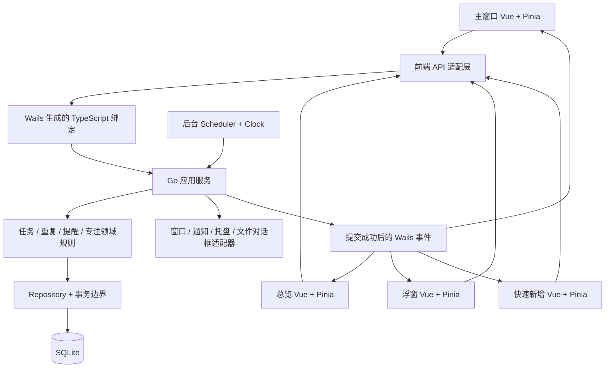
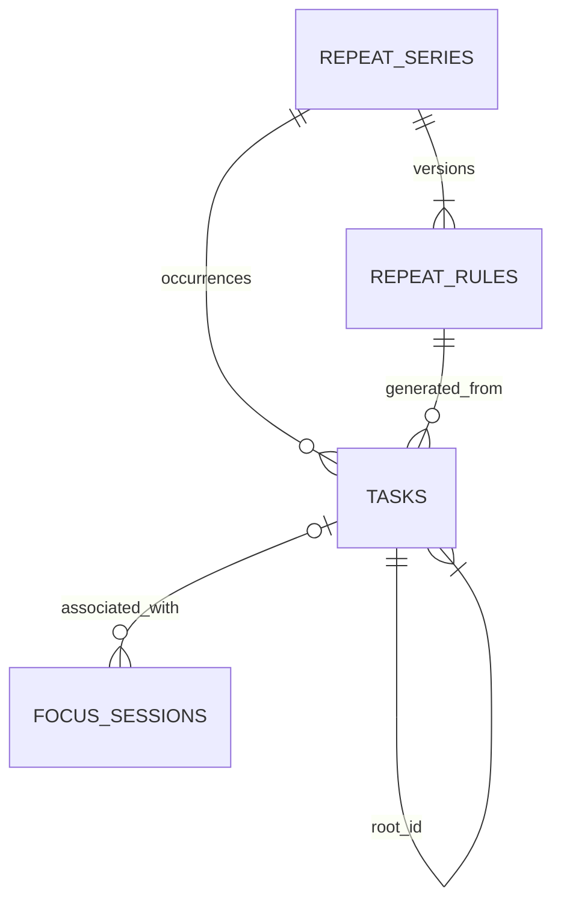
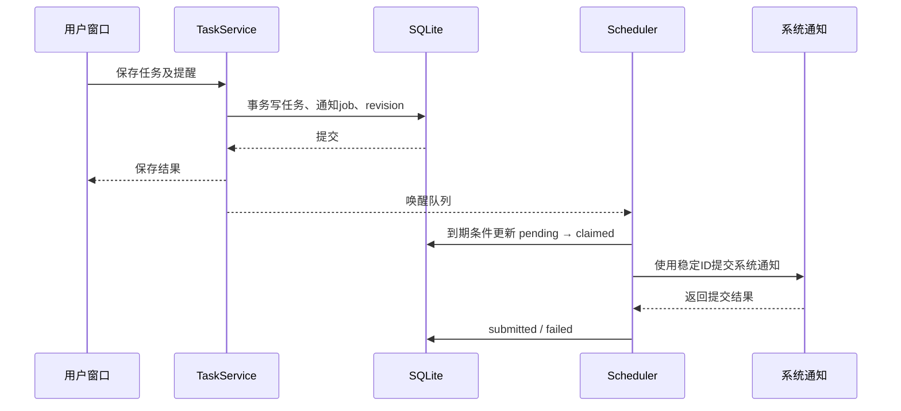

# SimpleTodo 开发实现设计

> 2026-10-21 更新：单窗口、黑白灰、全量收集箱、行内编辑、自定义下拉和日历右抽屉以 [界面改版](界面改版.md) 为准；下文的多窗口、颜色入口及未完成页签描述已被该方案替代。

文档日期：2026-10-20。状态：设计基线，已完成首轮实现；当前目录、运行方式与验证记录见 [项目说明](../README.md)。

关联文档：[功能清单](功能清单.md)、[功能设计](功能设计.md)。本文保留开发前的架构约定。当前实现由 `internal/todo` 承担领域与存储，`todoservice.go` 承担 Wails 服务与原生集成，`frontend/src` 承担 Vue 界面；实际服务名称与目录以源码和项目说明为准。

## 1. 当前项目基线

以下来自本项目现有文件，不根据初始化 README 中的通用介绍猜测目录：

| 位置 | 当前情况 | 开发时的处理 |
| --- | --- | --- |
| `go.mod` | 模块名 `changeme`；Go 1.26.0；Wails `v3.0.0-beta.33` | 先沿用版本验证；确定模块路径后统一修改并重新生成绑定 |
| `main.go` | 嵌入 `frontend/dist`，注册 GreetService，创建演示窗口，每秒发送 time 事件 | 改为组合根，注入数据库、服务、桌面适配器；移除示例事件及无限演示循环 |
| `greetservice.go` | 演示问候服务 | 业务骨架建立后移除 |
| `frontend/package.json` | Vue `^3.2.45`、Vite `^8.0.5`、TypeScript `~5.9.3`，Wails runtime 使用 `latest` 范围 | 锁定兼容的实际版本；添加 Pinia、Tailwind 4；同步锁文件 |
| `frontend/vite.config.ts` | Vue 与 Wails 插件，绑定目录 `./bindings` | 保留现有接入方式并追加 Tailwind Vite 插件 |
| `frontend/src` | App + HelloWorld 示例，尚无业务状态管理 | 建立按功能划分的组件、stores、API 层 |
| `Taskfile.yml`、`build/` | 已含各平台构建任务和模板元信息 | 继续使用 Wails 3 Taskfile 工作流；替换产品名称、标识和打包信息 |
| SQLite、Pinia、Tailwind | 当前业务配置中尚未接入 | 在实施阶段引入，本轮只输出文档 |

当前仓库根目录没有 `.codegraph/`，本次按普通文件检查；不创建索引。模板虽包含 Linux/移动端构建目录，本轮支持范围仍是 macOS 优先、Windows 兼顾。

## 2. 技术决策

| 领域 | 选择 | 原因与约束 |
| --- | --- | --- |
| 桌面框架 | 当前固定版本 Wails 3 | 通过 Go Service 绑定调用和事件通信，不增加独立 HTTP 业务服务 |
| 前端 | Vue 3 Composition API + TypeScript + Vite | 延续当前模板；业务 DTO 与 Go 绑定保持一致 |
| 样式 | Tailwind CSS 4 + `@tailwindcss/vite` + CSS 变量 | 使用 v4 的 CSS 入口与主题变量，不套用 v3 的配置方式；语义颜色集中管理 |
| 状态管理 | Pinia | 每个 WebView 独立实例，保存当前快照、筛选、草稿与加载状态；不作为持久化数据库 |
| 数据库 | SQLite，经 Go `database/sql` 访问 | 所有业务读写集中在 Go；前端不直接打开数据库 |
| SQLite 驱动 | 推荐 `modernc.org/sqlite` | 无需驱动自身的 CGo；不意味着整个 Wails 应用不需要平台原生构建工具。M0 锁定与 Go 1.26、目标平台兼容的具体版本 |
| SQL 组织 | 显式 SQL + Repository，暂不引入 ORM | 表和查询规模可控，便于审查事务与重复生成逻辑；避免领域规则藏在 ORM hooks 中 |
| 数据迁移 | 内嵌、顺序执行的 SQL 迁移 + `schema_migrations` | 每次升级有版本、校验值和事务；失败回滚，不自动降级 |
| 日期计算 | Go 标准库日历运算，注入 Clock；日期字符串独立于时间戳 | 不用“加 24 小时”表示跨日，不把日期字符串交给 JS Date 隐式解析 |
| 图标与资源 | 本地图标组件、系统字体与随包资源 | 不依赖 CDN、在线字体和运行时下载 |
| 路由 | 首版无需 Vue Router | 用稳定窗口入口参数及主窗口视图状态；以后出现复杂内部导航再引入 |

Tailwind 4 的官方浏览器基线包括 Safari 16.4、Chrome 111 等，因此最低系统版本必须结合 WKWebView 与 WebView2 实测确定，不能只看 Wails 能否启动。参考 [Tailwind 安装](https://tailwindcss.com/docs/installation/using-vite)、[兼容性](https://tailwindcss.com/docs/compatibility)。Pinia 使用方式参考 [官方核心概念](https://pinia.vuejs.org/core-concepts/)，驱动能力参考 [modernc SQLite 文档](https://pkg.go.dev/modernc.org/sqlite)。

## 3. 总体架构与职责



- Vue 组件：渲染与交互；业务操作通过 store action，不直接散落绑定调用。
- Pinia：持有视图快照、选择、草稿、错误、请求状态；不运行重复生成、不做后台提醒、不持久化任务到 localStorage。
- Go 应用服务：参数校验、冲突检测、事务、跨实体规则、提交后的事件通知。
- 领域层：任务树校验、子树完成与祖先汇总、重复日期推算、延期筛选、倒计时下一次计算，可脱离桌面环境测试。
- Repository：SQL、索引、分页、CAS 更新和事务内读写，不调用窗口 API。
- Scheduler：进程级唯一，处理日期变化、补偿、提醒到期、专注结束；不依赖任一窗口存活。
- Desktop Adapter：封装 Wails 与平台差异，向前端返回能力与结果，不把原生细节侵入业务模型。

普通 CRUD、子树变更及祖先联动、同一次批量操作、重复规则变更在一个业务事务中提交。任一子任务的内容、结构或状态变化均递增所属根任务 version，以整棵树作为并发冲突边界。导入整体替换、恢复和目录迁移属于维护操作，走独立的全局维护锁与停写流程。

### 建议目录（开发阶段创建）

```text
main.go                          # 组合根
internal/
  app/                           # 启动、关闭、依赖装配、维护状态
  domain/                        # task、recurrence、reminder、focus、countdown
  service/                       # Wails 绑定应用服务与 DTO
  repository/sqlite/             # SQL 与事务
  storage/migrations/            # 内嵌迁移
  scheduler/                     # 日期补偿、到期队列、Clock 接口
  desktop/                       # 窗口、通知、快捷键、自启与托盘适配
  transfer/                      # 文本/Markdown/CSV/HTML/JSON 编解码
  backup/                        # 快照、恢复、目录切换
frontend/src/
  app/                           # 窗口入口选择、初始化与事件注册
  components/base/               # 对话框、按钮、菜单、输入、提示
  features/                      # tasks、calendar、mini、focus、countdown、settings
  stores/                        # tasks、view、settings、timer、app
  api/                           # 生成绑定的稳定封装、错误映射
  composables/                   # 快捷键、拖动、主题、订阅清理
  styles/                        # Tailwind 4 入口、语义 token
frontend/bindings/                # Wails 自动生成，禁止手工修补
docs/                            # 本轮三份设计文档
```

不把以上目录提前生成空壳；以里程碑实际开发需要创建。

## 4. SQLite 数据模型

### 4.1 存储约定

数据库文件为 `simpletodo.db`。主键由 Go 生成随机 UUID 字符串；跨桥接传递的 64 位版本号/序列号用十进制字符串，避免 JavaScript 数值精度边界。时间戳统一为 UTC Unix 毫秒 INTEGER；计划日期使用 `YYYY-MM-DD` TEXT，时分使用 `HH:mm` TEXT；时区使用 IANA 名称。

所有业务实体有 `created_at`、`updated_at`、`version`；version 每次更新递增。日期、字符数和枚举由 Go 严格校验；数据库继续用 NOT NULL、CHECK、外键、唯一索引约束关键不变量。空日期使用 NULL，不能混用空字符串。

### 4.2 表结构

| 表 | 关键字段 | 关系、用途与约束 |
| --- | --- | --- |
| `tasks` | id、parent_id、root_id、title、description、planned_date、original_planned_date、status、color、sort_order、completed_at、auto_postpone_policy、series_id、rule_id、occurrence_date、is_exception、remind_at、reminder_local_time、reminder_timezone、reminder_generation、version | 唯一任务表，保存根任务、重复根实例及所有层级子任务；parent_id 指向本表直属父节点，root_id 指向本表根节点；字段与约束见下节 |
| `repeat_series` | id、stopped_from、version | 系列稳定身份；停止日期为该日及以后不再产生新实例 |
| `repeat_rules` | id、series_id、effective_from、effective_to、anchor_date、frequency、interval_n、weekdays、month_day、template_tree_json、reminder_local_time、generated_through、version | 不重叠的生效区间，effective_to 含当天；template_tree_json 保存根及全部后代的版本化模板快照，不另建子任务模板表；旧规则版本不覆盖 |
| `focus_sessions` | id、task_id（可空）、task_title_snapshot、duration_seconds、remaining_seconds、deadline_at、state、started_at、finished_at、version | state=running/paused/completed/stopped；task_id 外键指向 tasks，服务限定关联根任务；删除后置空，标题快照保留；运行时 deadline 为准，暂停时 remaining 为准 |
| `countdowns` | id、name、all_day、anchor_local_date、anchor_local_time、target_at、timezone、repeat_frequency、enabled、reminder_offset_seconds、generation、version | 独立事项，不冒充任务；保存重复锚点避免月末漂移；当前目标 UTC 与本地重复规则并存 |
| `notification_jobs` | id、source_type、source_id、generation、cycle_key、fire_at、state、claimed_at、submitted_at、error_code | 待办、专注、倒计时共用；state=pending/claimed/submitted/missed/expired/cancelled/failed/uncertain；有稳定去重键 |
| `settings` | key、value_json、value_schema_version、version | 允许列表配置，不存 AI、同步或认证字段；OS 注册状态从系统读，不由此表假装成功 |
| `window_states` | window_key、display_id、x、y、width、height、mode、background_opacity、collapsed、version | DIP 坐标；初始化时根据当前屏幕工作区修正 |
| `holiday_days` | date、name、kind、dataset_version、source_label | kind=holiday/workday；仅本地数据，覆盖年份由数据集元信息给出 |
| `command_receipts` | command_id、request_hash、result_json、created_at | 对新增、导入、复制等操作重试去重；同 ID 不同参数拒绝；正常保留 7 天 |
| `app_meta` | key、value | 数据集标识、全局 data_revision、最近日期补偿结果等，不承载界面草稿 |
| `schema_migrations` | version、checksum、applied_at | 架构版本和迁移校验，不能用应用版本号替代 |

`tasks` 的 skipped 根行是阻止重复再生的必要记录，不能随界面隐藏进行清理；普通任务确认删除可物理删除。重复规则、已完成实例与例外在完整 JSON/备份中必须保留。

#### 4.2.1 统一 tasks 表的字段职责

| 字段/字段组 | 根任务记录 | 子任务记录 |
| --- | --- | --- |
| `id` | 本节点 UUID 主键，NOT NULL | 同一命名空间的 UUID 主键，NOT NULL |
| `parent_id` | NULL，唯一的根节点判定条件 | NOT NULL，始终为直属父记录 ID；顶层子任务填根任务 ID |
| `root_id` | NOT NULL，等于自身 id | NOT NULL，等于所在树根任务 id，不能等于自身 id |
| `title`、`sort_order` | 根标题、日期列表内顺序 | 本节点标题、直属兄弟组内顺序 |
| `status`、`completed_at` | pending/completed/skipped；skipped 只用于重复单次删除 | 仅 pending/completed；由节点操作与后代汇总维护 |
| `description`、`color` | 根任务日程内容 | 必须为 NULL，通过 root_id 读取根记录后得到有效值 |
| `planned_date`、`original_planned_date`、`auto_postpone_policy` | 根任务的计划、原日期与延期策略；收集箱 planned_date=NULL | 必须为 NULL，继承根日程，不重复保存 |
| `series_id`、`rule_id`、`occurrence_date` | 普通根任务三者全空，重复根实例三者均非空 | 必须为 NULL，重复归属通过 root_id 得到 |
| `remind_at`、`reminder_local_time`、`reminder_timezone` | 根任务独立提醒配置 | 必须为 NULL，不创建独立子任务提醒 |
| `is_exception`、`reminder_generation` | 根实例例外标志、提醒版本，默认 0 | 固定 0；修改子节点时更新对应根记录的标志/版本 |
| `version`、`created_at`、`updated_at` | 根版本同时作为整棵树冲突版本 | 节点版本与时间独立记录，更新时同步递增根版本 |

子任务树不额外持久化 depth 或路径字符串；root_id 是稳定树归属的受控冗余，用于整树查询、同根约束与继承根字段。深度、祖先路径、叶节点进度和半选态由当前树计算；不设固定业务层数，单根最多 200 个子任务的上限包含全部层级。读取 DTO 可填充继承后的显示值，但不能把这些值回写到子记录的根专属字段。

template_tree_json 是规则版本的配置快照，不是另一套运行任务记录。使用本地 nodeKey、parentKey、title、sortOrder 和根属性表示一棵树，根 parentKey=NULL，其余节点引用直属父 key；节点总数、环、必填和根专属属性按任务树相同规则校验。模板不保存真实任务 ID 或执行状态，不参与日历/未完成查询；实际发生的每一个节点只写入 tasks。

### 4.3 关系示意



通知来源采用显式 source_type + source_id 的多态引用，SQLite 无法对此直接建单一外键；服务必须在同一事务中创建、取消和清理关联 job，并由启动一致性检查识别孤立 job。领域实体不能依赖前端帮忙清理通知。

### 4.4 表索引配置与约束

以下是迁移需要配置的索引规格和 SQL 设计稿，不是本轮已创建的数据库。各表主键由 PRIMARY KEY 提供，无需再为相同单字段创建普通索引；UUID/TEXT 主键必须显式 NOT NULL。

#### 4.4.1 tasks 索引

| 索引名 | 列顺序 | 类型/条件 | 覆盖的查询或约束 |
| --- | --- | --- | --- |
| `ux_tasks_root_node` | root_id, id | 全量唯一索引 | 支持整树查询 root_id=?；为同根复合父外键提供候选键，不能以根部分索引替代 |
| `idx_tasks_children_order` | parent_id, sort_order, id | 普通索引，parent_id IS NOT NULL | 查询直属子节点、同级排序、按 parent_id 逐层遍历 |
| `idx_tasks_root_schedule` | planned_date ASC, status DESC, sort_order ASC, id ASC | 普通索引，parent_id IS NULL AND status<>'skipped' | 日期/范围、月历摘要、收集箱；NULL 日期用 IS NULL 查询 |
| `idx_tasks_root_pending` | planned_date, sort_order, id | 普通索引，parent_id IS NULL AND status='pending' | 所有未完成、按日期分组及延期候选扫描 |
| `ux_tasks_series_occurrence` | series_id, occurrence_date | 唯一索引，parent_id IS NULL AND series_id IS NOT NULL | 同一系列同一天最多一个根实例；必须包含 skipped，防止单次删除后再次生成 |
| `idx_tasks_rule` | rule_id, occurrence_date, id | 普通索引，rule_id IS NOT NULL | 按旧规则版本查找/清理未来实例，以及规则外键关联检查 |

```sql
CREATE UNIQUE INDEX ux_tasks_root_node ON tasks(root_id, id);

CREATE INDEX idx_tasks_children_order
    ON tasks(parent_id, sort_order, id)
    WHERE parent_id IS NOT NULL;

CREATE INDEX idx_tasks_root_schedule
    ON tasks(planned_date, status DESC, sort_order, id)
    WHERE parent_id IS NULL AND status <> 'skipped';

CREATE INDEX idx_tasks_root_pending
    ON tasks(planned_date, sort_order, id)
    WHERE parent_id IS NULL AND status = 'pending';

CREATE UNIQUE INDEX ux_tasks_series_occurrence
    ON tasks(series_id, occurrence_date)
    WHERE parent_id IS NULL AND series_id IS NOT NULL;

CREATE INDEX idx_tasks_rule
    ON tasks(rule_id, occurrence_date, id)
    WHERE rule_id IS NOT NULL;
```

所有日计划/收集箱/根任务计数的 SQL 必须显式包含 parent_id IS NULL；否则子任务的 NULL 日程字段会被误算为收集箱。读取整树使用 root_id=?，其中已包含根记录；直属子任务使用 parent_id=?。使用部分索引的查询须写明与索引一致的条件，日/月摘要显式写 status<>'skipped'，未完成列表显式写 status='pending'。

根列表完成置底按 status DESC、sort_order、id 排序；颜色顺序是业务预设，在按日期查询后的有限结果上排序，首版不增加颜色表达式索引。root_schedule 和 root_pending 对应不同选择率及排序，保留两者；不再重复添加单列 status/planned_date/root_id 索引。

所有未完成视图要求收集箱排最后，因此先按 planned_date IS NOT NULL 查询已排期根记录，再读取 planned_date IS NULL 的根记录并追加；分页游标包含当前分区。两段都使用 root_pending 的条件，不能直接依赖 SQLite 默认 NULL 排序而把收集箱放到日期前面。

#### 4.4.2 其他表索引

| 表 | 索引配置 | 用途 |
| --- | --- | --- |
| `repeat_series` | PRIMARY KEY(id)，无需额外索引 | 系列按 ID 定位，是否停止为规则计算条件 |
| `repeat_rules` | PRIMARY KEY(id)；`ux_repeat_rules_series_from(series_id, effective_from)` 唯一 | 按系列及生效时间读取版本；唯一开始日不能替代生效区间不重叠校验 |
| `focus_sessions` | PRIMARY KEY(id)；`ux_focus_one_active((1))` 部分唯一；`idx_focus_task(task_id)` 部分普通 | 全库最多一个 running/paused 会话；任务删除时定位关联会话 |
| `countdowns` | PRIMARY KEY(id)；`idx_countdowns_enabled_target(target_at, id) WHERE enabled=1` | 查找已启用且到期、需要推进下一周期的事项 |
| `notification_jobs` | PRIMARY KEY(id)；`ux_notification_source_cycle(source_type, source_id, generation, cycle_key)` 唯一；`idx_notification_state_fire(state, fire_at, id)` 普通 | 来源/周期去重、到期领取、claimed 恢复与错过提醒查询 |
| `command_receipts` | PRIMARY KEY(command_id)；`idx_command_receipts_created(created_at)` 普通 | 命令去重与按 7 天保留期清理 |
| `settings` | PRIMARY KEY(key)，无需额外索引 | 读取与修改指定设置 |
| `window_states` | PRIMARY KEY(window_key)，无需额外索引 | 按窗口恢复位置与外观 |
| `holiday_days` | PRIMARY KEY(date)，无需额外索引 | 按日/年月范围查询，日期 ISO 文本可按字典序比较 |
| `app_meta` | PRIMARY KEY(key)，无需额外索引 | 全局版本、数据集标识读取 |
| `schema_migrations` | PRIMARY KEY(version)，无需额外索引 | 迁移版本定位与排序 |

```sql
CREATE UNIQUE INDEX ux_repeat_rules_series_from
    ON repeat_rules(series_id, effective_from);

CREATE UNIQUE INDEX ux_focus_one_active
    ON focus_sessions((1))
    WHERE state IN ('running', 'paused');

CREATE INDEX idx_focus_task ON focus_sessions(task_id)
    WHERE task_id IS NOT NULL;

CREATE INDEX idx_countdowns_enabled_target
    ON countdowns(target_at, id) WHERE enabled = 1;

CREATE UNIQUE INDEX ux_notification_source_cycle
    ON notification_jobs(source_type, source_id, generation, cycle_key);

CREATE INDEX idx_notification_state_fire
    ON notification_jobs(state, fire_at, id);

CREATE INDEX idx_command_receipts_created ON command_receipts(created_at);
```

notification_jobs 去重键四列均 NOT NULL；独立一次性通知也需要确定的 cycle_key，不能用 NULL 绕过唯一约束。主键、外键候选键和辅助索引在同次 schema 迁移中定义，禁止靠应用启动时反复 CREATE INDEX 掩盖迁移缺失。

#### 4.4.3 外键与树形约束

- `root_id REFERENCES tasks(id) ON DELETE CASCADE` 保证根 ID 存在；根记录插入时 root_id=id。此自引用外键采用 DEFERRABLE INITIALLY DEFERRED，在同一事务提交时校验完整树。
- `(root_id, parent_id) REFERENCES tasks(root_id, id) ON DELETE CASCADE` 使用 ux_tasks_root_node，约束直属父节点与本节点同根；仅根记录 parent_id 可为 NULL。根的自身归属通过上一条外键校验。
- CHECK 约束根记录 `parent_id IS NULL AND root_id=id`、子记录 `parent_id IS NOT NULL AND root_id<>id`，二者必须满足其一；禁止 parent_id=id。服务另行验证 root_id 指向的确实是根记录，并禁止修改已保存节点的 id、root_id 或把根直接改为子节点。
- 子记录的根专属字段按 4.2.1 强制为空/0；只有根重复实例能使用 skipped；完成状态须有 completed_at，pending/skipped 的 completed_at 为空；普通根和子记录的重复三字段全空，根重复实例三字段全非空；重复根不允许有效延期配置开启。
- series_id、rule_id 分别引用对应表，服务验证 rule_id 所属 series_id 一致。保留规则版本及其被引用历史，不在删除后续实例时顺手删除仍被历史引用的规则。
- 自引用外键不能防止间接循环；每次新增、重挂父节点、导入都在事务内检查环、根的真实身份和每根 200 后代上限。根/分支删除分别触发整树/对应子树级联，不删除节点的祖先。
- 根重排按日期列表、子节点重排按同一父 ID 的兄弟组分别编号；sort_order 不做唯一键，用 id 作为稳定次排序字段，避免批量重编号过程的中间唯一冲突。

#### 4.4.4 索引验收

迁移测试使用 PRAGMA index_list/index_info 核对索引存在、列顺序及唯一标志，并从 sqlite_schema 核对部分索引条件。用真实规模样本及 EXPLAIN QUERY PLAN 验证日/月、收集箱、未完成、root_id 整树、parent_id 直属子节点、规则实例和通知到期查询；不要求优化器在空表或小表上强制选索引，也不使用 INDEXED BY 固定执行计划。

任务更新的 CAS 条件使用主键 id 和 version，已有主键已将目标缩小到单行，不另建 `(id, version)` 索引。增加索引应由新增查询与实测支撑，避免为每个字段无差别建索引。

### 4.5 连接与事务

开启 `foreign_keys=ON`、`journal_mode=WAL`、`busy_timeout=5000`，初始选择 `synchronous=FULL`。每个连接都必须正确应用连接级 PRAGMA。首版写入统一经过单写连接与短事务，读连接池最多 2 个；所有多步读取用短只读事务保持快照，不能把 UI 等待放在事务中。

不同步保存的外部通知、文件写入和窗口操作不能夹在数据库写事务中。数据库更新提交后再执行副作用；需要可靠重试的副作用先写入 job。事务失败时不增加 data_revision、不发送业务变更事件。

WAL 是本地文件模式，不支持将同一数据库放到网络文件系统并发共享。备份需一致性快照，不能只复制主 `.db` 忽略 WAL。依据：[SQLite WAL](https://sqlite.org/wal.html)、[外键](https://sqlite.org/foreignkeys.html)。

## 5. Wails 服务与接口契约

### 5.1 对外服务划分

| 服务 | 计划接口 | 关联功能 |
| --- | --- | --- |
| `BootstrapService` | GetSnapshot、GetCapabilities、GetAppInfo | 初始设置、今日日期、数据版本、平台能力；F30—F33 |
| `TaskService` | ListTasks、GetTask、GetTaskTree、CreateTask、UpdateTask、CreateNode、UpdateNode、SetCompleted、DeleteSubtree、MoveTask、ReparentSubtree、ReorderTasks、ReorderSiblings、BatchMutate | F01—F09、F14；统一管理根及全部层级节点，复用 tasks Repository；根操作含整树，节点操作含对应子树及祖先汇总 |
| `RecurrenceService` | PreviewRule、CreateSeries、UpdateOccurrence、UpdateFollowing、StopFollowing | F10，所有变更提供影响数量预览 |
| `CalendarService` | GetMonth、GetRangeSummary、GetHolidays | F13—F15；月历和批量选择复用 Task 查询语义 |
| `FocusService` | GetActive、Start、Pause、Resume、Stop | F19 |
| `CountdownService` | List、Save、Delete、SetEnabled | F20 |
| `ReminderService` | GetPermission、RequestPermission、ListMissed、SetTaskReminder、DismissMissed | F12，复用后台调度 |
| `TransferService` | PreviewImport、CommitImport、PrepareCopy、PreviewPaste、CommitPaste、Export | F21—F23 |
| `BackupService` | ListBackups、CreateBackup、InspectBackup、RestoreBackup、MigrateDataDir | F24—F25 |
| `SettingsService` | GetSettings、PatchSettings、ImportHolidayDataset | F11 默认设置、F15、F30—F31 |
| `DesktopService` | ShowWindow、HideWindow、SetWindowMode、SaveWindowState、ConfigureShortcut、SetAutostart、OpenDataDir、OpenReleasePage、Quit | F16—F18、F26—F29、F32 |

F11 的延期由内部服务执行，不暴露一个可绕过规则的任意日期 SQL 接口。F33 的一致性与故障处理横切以上服务。

接口表是逻辑契约，不预先保证这些名称就是 Wails 现成 API。外部 OS API 由 Desktop Adapter 统一封装，业务服务的方法由项目实现后才生成绑定。

### 5.2 输入、输出与错误

变更请求携带 commandId；更新请求携带 expectedVersion；子任务请求额外携带 rootTaskId、nodeId（创建时由 Go 生成）及 expectedRootVersion，层级移动携带目标 parentId、同级锚点 ID。rootTaskId 映射数据库 root_id，后端从实际记录核对，不信任调用方归属声明。只有根节点 parentId=NULL；创建根直属子任务或将子树移到顶层时，parentId 必须等于根任务 ID。重排/批量操作携带 scopeRevision（由服务端在预览时发出），删除和系列修改也需要预览令牌。令牌绑定查询范围、节点 ID、根任务版本、动作和有效期 5 分钟；实际提交重新核对，不信任前端提供的根任务数、后代数量或深度。

ListTasks 支持 view=day/inbox/all_pending、date/range、includeCompleted、sort、cursor、limit。单页默认 100、最多 500 条，游标绑定排序与过滤条件；连续日期请求最多 366 天，跨年导出在后台分段读取同一逻辑快照。月历请求只返回摘要及每格前几条，详情按需加载，不传整库给 WebView。

ListTasks 固定用 parent_id IS NULL 按根任务分页，返回后代总数、叶节点完成进度及根版本，不从任意层级切断一棵树。GetTaskTree 用 root_id=? 在同一读快照返回根及最多 200 个后代的统一节点数组（带 root_id、parent_id 和同级顺序）；Pinia 按根版本替换整树，再构造可见节点列表，不以分批过期节点拼接父子关系。

结果包含实体 DTO、当前 dataRevision、commandId；预览返回影响数量、保留例外、警告和 previewToken。业务错误统一为 code、message、fieldErrors、retryable、currentVersion；实际绑定用明确的命名 DTO 封装，不依赖 Go 泛型方法是否能被生成器支持。

| code | 使用场景 | 前端动作 |
| --- | --- | --- |
| VALIDATION_ERROR | 空标题、无效日期、字段超长 | 定位字段，保留输入 |
| NOT_FOUND | 任务已被删除 | 提示并刷新列表，保留可复制草稿 |
| CONFLICT | version 或 scopeRevision 不匹配 | 读取最新版本，用户决定重试 |
| PREVIEW_EXPIRED | 预览过期或导入源改变 | 重新预览，不直接提交 |
| DB_BUSY / IO_ERROR / DISK_FULL | 锁等待、只读、磁盘问题 | 有限重试或显示可执行处理方式 |
| PERMISSION_DENIED | 文件/系统权限不足 | 指向相应设置或重新选择路径 |
| UNSUPPORTED | 平台能力缺失 | 显示能力说明和替代操作 |
| MAINTENANCE_MODE | 恢复或迁移进行中 | 阻止写入并显示维护状态 |

数据库使用参数化语句；字符串长度按 Unicode 字符规则校验。日期、频率和预览约束同时在 Go 校验；前端校验只负责即时反馈。

### 5.3 Pinia 与多窗口事件

| Store | 内容 | 不承担的职责 |
| --- | --- | --- |
| taskStore | 根任务查询结果、按根保存的节点索引/树版本、分页、保存状态 | 不推算下次重复或写 SQLite |
| viewStore | 选中日期、视图、折叠节点集合、分支聚焦路径、选择范围、草稿 | 不跨窗口共享瞬时焦点与折叠选择 |
| settingsStore | 后端已确认设置、平台能力 | 不把写 localStorage 当保存成功 |
| timerStore | 会话快照、服务端时间偏移、展示剩余值 | 不决定后台到期和通知 |
| appStore | 初始化、维护、全局错误、最近 dataRevision | 不把事件流当可靠日志 |

每个 WebView 独立 Pinia。Go 在同一业务事务中更新实体及全局 data_revision，提交后广播 `tasks:changed`、`settings:changed`、`focus:changed`、`countdowns:changed` 等事件，携带 datasetId、dataRevision、变更 ID 和受影响日期。恢复或目录切换通过 `app:maintenance` 和 `app:data-replaced` 通知清空快照；全局日期变化发 `app:date-changed`。

初始化顺序为“注册事件监听 → 获取快照 → 合并缓冲期间的更新 → 查询当前列表”；事件只触发查询失效，不直接以不完整 payload 覆盖实体。相同/旧版本忽略；数据集变化、版本跳跃或窗口重新获得焦点时拉取最新 revision 并按需重读。多个列表请求使用序号丢弃过期响应，避免快速切日期后旧结果覆盖新日期。

数据库已提交但发事件前进程退出时，数据仍存在；窗口重启/重新聚焦获取快照即可恢复，因此不为普通 UI 刷新建立持久消息队列。command_receipts 与业务写入同事务保存，调用结果丢失时重试原 commandId 返回原结果；超过 7 天不自动重放未决命令，要求重新查询确认。

首版对持久化变更采用提交成功后更新视图，勾选期间显示短暂 pending 状态；可避免乐观回滚和多窗口联动复杂性。后续如优化为乐观更新，仍必须保留 version 与失败恢复协议。

子任务变更事件始终携带 rootTaskId 与根版本，其他窗口使该根的整棵树快照失效。折叠状态以节点 ID 保存在当前窗口视图中；节点删除或复制后移除失效 ID，不能用行号作为稳定节点身份。

## 6. 核心算法与后台生命周期

### 6.1 重复实例生成

采用“版本化模板 + 有限区间物化 + 单次例外”，不在前端无限展开。

1. 创建系列时保存初始规则及模板；每个规则版本有不重叠的生效区间和独立 generated_through。
2. 启动、跨日、查询月历/日期范围时，根据规则日历计算需补齐的日期。默认后台至少生成到今天后 7 天；“所有未完成”先补齐系列开始至今天的历史缺口，不漏掉离线期间应出现的实例。
3. 从 generated_through 的下一天起连续生成，直至需要的上界或规则终止日。每个实例解析规则的 template_tree_json，建立“模板 nodeKey → 新任务 ID”映射，根设置 root_id=id、parent_id=NULL，后代统一设置本次 root_id 并按映射重写 parent_id；所有节点仅写入 tasks，不在不同实例间复用节点 ID。按月份/最多 500 次实例、累计最多 2,000 个任务节点（先到者）分短事务提交；每次同时写完整 tasks 树、提醒 job 与水位，一棵树不能拆成部分成功。未来提醒正常挂起；过去 24 小时内首次补齐的提醒也创建 job，随后进入错过摘要；更早的记录直接标记过期，不能因为补齐而突然逐条通知。大量历史补齐显示进度，完成前不显示虚假的完整统计。
4. `series_id + occurrence_date` 唯一约束防止并发或重试重复生成。只针对这条唯一约束处理冲突，不用宽泛 INSERT OR IGNORE 掩盖其他约束错误。已存在 completed/skipped/exception 实例直接保留。
5. “本次及以后”从切点截断旧规则并创建新版本；去掉该日起未完成且未修改的旧实例及其未发通知，新版本按其范围重建。已完成、skipped 和单次例外继续占有相同系列日期，生成时不覆盖。
6. “删除本次及以后”同事务停止规则并删除范围内所有未完成实例及关联 job，保留已完成实例；生成上界受 stopped_from 约束。

从普通任务转换时将该任务绑定为首实例，不另复制一条。任一系列变更与后台生成共用服务级互斥与数据库事务边界；预览后发生后台补齐导致范围变化时，提交须重新预览。

修改某次实例任意层级的内容、结构或完成状态，均将根实例 is_exception 置为 true；更新后续模板时保留例外整树，不能只保留例外节点而混入新模板的其他分支。

每日用本地日历天数差判断间隔；每周以周一所在周及 weekdays 判断；每月以 anchor 月份差与 month_day 计算。禁止依靠上一次月底实例加一个月导致永久漂移。所有生成限定在产品支持日期范围内，查询超界明确报错。

### 6.2 自动延期

在进程级补偿流程中，获取当前本地 today，查询 parent_id IS NULL、planned_date < today、status='pending'、series_id IS NULL，且有效延期配置开启的根任务。按原日期和顺序稳定移动到今天，首次记录 original_planned_date，同事务取消过期 job、提升实体版本和全局 revision。

重复执行时这些任务已经是 today，因此不会再次移动；不以“上次补偿日期”作为唯一去重依据。多级子任务通过 root_id 继承新日期，无需逐节点改写日期字段，层级与状态保持不变。一次大批量延期按预先确定的业务批次执行，期间界面显示补偿状态，避免用户在过渡状态改写同一批任务。

### 6.3 多级任务树操作

1. 在写事务内校验 expectedRootVersion、节点实际 root_id 和目标父节点，再从 tasks 按 root_id 加载完整邻接关系。新根以自身 ID 为 root_id 且 parent_id=NULL；新增任何层级子节点，都用实际父记录 ID 作为 parent_id 并继承该父记录 root_id。以迭代遍历或受控递归查询获取后代与祖先，任何遍历都检测重复访问，发现坏树则中止并报告，不无限递归。
2. 完成/取消完成更新目标节点及全部后代，随后按从深到浅的顺序重算祖先；半选态和叶节点进度由树计算，不增加第三种持久化完成状态。新增、删除、重挂父节点后同样更新相关祖先链；失去最后子节点时按《功能设计》保留操作前状态。
3. 重挂父节点仅限同根，目标不能是自身或自己的后代。只改变子树根的 parent_id，不重写其后代关系或任意节点的 root_id；调整源、目标兄弟顺序，同时校验总节点数。缩进/提升是这一操作的受限形式，提升到根直属层时 parent_id=根 ID，不能设为 NULL 制造第二个根。
4. 删除子树先预览节点集合，提交时核对根版本；在同一事务中删除完整后代、更新原祖先并递增根版本。整树删除由 tasks 外键触发级联。批量输入含祖先和后代时先归并覆盖关系，避免重复计数或重复更新。
5. 所有受影响节点的版本与 completed_at 按状态变化更新；根版本在同一命令中递增一次，全局 data_revision 递增一次。任一步失败全部回滚，多窗口只接收提交后的完整结果。

### 6.4 提醒调度与去重

Scheduler 从 SQLite 加载最近待发 job，用可重置计时器等待下一到期点，最长每 30 秒复核时间及队列；任务修改立即唤醒重载。启动、休眠恢复、时区/时钟变化时都重新扫描，不靠固定间隔累加时间。



job 的 generation 随提醒修改变化，cycle_key 标识重复日期或倒计时周期。到期领取使用条件更新，投递前再次检查来源仍存在且有效。完成/删除与投递使用相同来源锁排序，避免已取消提醒被正常路径再次发送；已经提交系统的通知只能尽力撤回，不能承诺撤销用户已看到的横幅。

系统通知与 SQLite 无法组成原子事务。若进程在系统提交后、状态写回前崩溃，claimed job 重启后标为 uncertain，不自动重发，进入应用内错过提醒列表；优先避免重复弹窗，接受极小窗口内可能漏掉系统横幅。不声称跨进程崩溃仍能“恰好一次”。普通失败在当前到期后 5 分钟内最多重试 3 次，过期转入错过列表，避免不断弹窗。

过去 24 小时内的未处理 job 合并一条摘要通知，摘要也有稳定去重标识；更早的标 expired。时区改变重建受本地重复规则控制的未来任务提醒；重复倒计时保持当前目标 UTC 不变，从下个新周期起使用新时区。固定 UTC 目标保持。显式维护状态期间不领取新 job，恢复后统一补偿。

### 6.5 专注与倒计时

专注开始/继续在数据库写 deadline_at，暂停写 remaining_seconds 并取消旧 job。前端根据后端时间偏移计算剩余显示；后台检查 UTC deadline，不每秒写数据库。重启后从状态恢复，不能因为 WebView 重建就重新开始 25 分钟。

运行中正常计时可使用 Go 单调时钟减少显示抖动；持久化与跨休眠/重启按现实经过时间。系统时钟发生大幅变化时按已持久化 UTC 目标重算并提示，不承诺把人为改钟当作精密计时器场景。

事项倒计时单独存目标时刻和重复锚点。fire_at = target_at - offset；提醒发生后不提前推进 target_at，真正到达目标时再计算下一周期。长时间离线直接推算下一个未来周期并保留一个错过摘要，不逐周期重放通知。每日/周/月重复遵循本地日历与夏令时规则。

### 6.6 启动与关闭

启动：读取固定路径 bootstrap 配置 → 申请应用单实例/数据目录锁 → 校验并打开原库 → 必要的保护备份与事务迁移 → 日常备份 → 恢复 job 与专注 → 补齐重复 → 自动延期 → 处理错过提醒 → 注册托盘、自启状态和快捷键 → 启动 Scheduler → 按启动原因显示主窗口。

迁移前遇更高 schema 版本时拒绝写入；原库损坏时进入恢复界面，不生成新库覆盖。第一次运行不存在数据库时才创建新库。自启与手动启动要能区分；系统 API 若不能可靠给出原因，由登录启动配置参数配合实现并在 M0 验证。

关闭：确认活动专注/近期提醒 → 停止接收新命令 → 取消 Scheduler context → 等待当前短事务和通知工作退出 → 保存窗口状态 → 注销快捷键/托盘 → 关闭连接并释放锁。所有后台 goroutine 可取消，不沿用示例中的无边界循环。

## 7. 文件交换、备份与恢复

### 7.1 文件和剪贴板

读取和保存由 Go 原生文件对话框选择路径，前端只接收受限句柄/令牌及显示名，不暴露任意文件读写方法。导入预览解析到有期限的 Go 缓存，token 绑定内容哈希、格式、目标与动作；提交时源内容变化或应用退出则要求重新预览。

普通文本每行一条根任务；Markdown 为多级复选框清单语法，日期标题使用本项目约定，每 2 个空格增加一级，Tab 预览时转换为 2 空格。解析时用缩进栈构树，禁止跳级；树形预览保留行号，校验整根节点总数后，按叶到根规范化完成状态。导出按同级顺序深度优先遍历；纯文本用于阅读，不承诺再次按普通文本导入恢复结构。

导出 JSON 的顶层包含 formatVersion、appVersion、exportedAt、datasetId 及各实体数组；仅用 tasks 数组保存全部任务节点，逐行包含 root_id、parent_id 与 sort_order；rules 数组保存 template_tree_json，不拆出子任务或模板节点数组。排除 OS 注册信息、command_receipts 和窗口机器坐标。导入按格式版本迁移，拒绝不认识的更高版本。对 tasks、series、rules 及内嵌模板树做全图校验，检查根身份、根字段只出现在根行、不存在的父节点、自环/间接环、跨根父引用、单根节点总量和状态汇总后入库。

完整交换 JSON 保留规则、单次例外、必要通知处理状态和专注记录，但重新部署时不盲目重放已发提醒。整体替换保持关联；合并/结构化复制建立“旧 tasks.id → 新 tasks.id”映射，同时重写每一行的 root_id、parent_id 及根的规则关联，不能只替换根 ID；模板使用局部 key，不引用真实任务 ID。JSON 合并禁用新副本提醒，活动专注转为停止记录。清单粘贴还需重置全部层级完成状态。若没有包含窗口设置，替换后采用本机现有/默认窗口布局。

Markdown/HTML 导出对内容转义；HTML 不输出用户可执行脚本。CSV 正确处理逗号、引号、换行与 UTF-8 BOM；对以 `= + - @` 开头的文本单元格进行公式注入保护，并在导出说明中标明用于表格安全显示。中文和 emoji 全程 UTF-8。

CSV 额外输出 root_task_id（对应 tasks.root_id）、parent_id、depth、sort_order，并按深度优先顺序排列：根行 parent_id 为空、depth=0；其余层级的 parent_id 均填真实直属父 ID，与数据库语义一致，无需对根直属子节点特殊转换。HTML 使用嵌套列表保留完整层级，不用固定两层 DOM 模板。

### 7.2 备份策略

首选 `VACUUM INTO` 生成临时目标，再检查 quick_check、foreign_key_check、schema 版本、基础行数，完成后同文件系统原子重命名为正式备份。执行前检查目标可写与空间，目标不可覆盖已有文件；路径通过驱动支持的参数绑定传入，不拼接用户 SQL。若选定驱动版本不能可靠支持这一通路，M0 验证 SQLite Backup API 作为替代，不使用直接复制活动主库。

日常备份命名含 UTC 时间与 schema 版本；元信息可从备份库读取，无需另建必须存在的 sidecar 文件。只有新备份成功后才清理超额日常备份；迁移前保护备份单独保留并可由用户手动删除。备份失败可继续普通编辑但必须显示警告；会替换原数据的恢复/迁移/整体导入若保护备份失败，必须中止。

依据：[SQLite Backup](https://sqlite.org/backup.html)、[VACUUM INTO](https://sqlite.org/lang_vacuum.html)。这些是完整快照；CSV、Markdown 不是完整恢复介质。

### 7.3 路径与维护切换

| 系统 | 默认业务目录 | 固定引导配置 |
| --- | --- | --- |
| macOS | `~/Library/Application Support/SimpleTodo/` | 同一默认目录内 `bootstrap.json`，记录实际 dataDir 和格式版本 |
| Windows | `%LOCALAPPDATA%\SimpleTodo\` | 同一默认目录内 `bootstrap.json`；用系统已知目录 API 获取，不写死用户名 |

实际数据目录包含数据库、backups、logs。bootstrap 保留在固定位置，数据目录迁移后仍可定位；包含敏感业务内容的设置留在数据库。日志限制大小与轮转，不记录任务全文、导入内容、绝对个人路径和剪贴板内容。备份与数据库默认均为本地明文，不声称自带加密。

恢复流程：维护锁 → 广播维护 → 停调度并拒绝写入 → 校验外部备份并在隔离临时副本中必要升级 → 创建当前库保护备份 → 关闭全部连接 → 将原库及 WAL/SHM 作为同一组隔离 → 同文件系统切换已验证库 → 重开校验 → 清理陈旧连接状态并重启。失败恢复原文件组，绝不把旧 WAL 附到新主库。

目录迁移使用快照复制而非跨盘 rename，校验新库后原子更新 bootstrap，再重启；新目录原已存在数据库时禁止静默覆盖。应用级单实例和目录级锁都覆盖迁移阶段。保留原目录；本机窗口位置可以保留，换机器导入则修正到可见工作区。

## 8. 桌面适配与平台能力

本地已检查 Wails `v3.0.0-beta.33` 源码，存在 SystemTray、GlobalShortcutManager、AutostartManager、SingleInstanceOptions、窗口 AlwaysOnTop/Bounds，以及 `pkg/services/notifications`。不能套用 Wails v2 的 runtime API 或假设浏览器 Web Notification 就能替代原生通知。

参考同一标签源码：[全局快捷键](https://github.com/wailsapp/wails/blob/v3.0.0-beta.33/v3/pkg/application/global_shortcut_manager.go)、[自启](https://github.com/wailsapp/wails/blob/v3.0.0-beta.33/v3/pkg/application/autostart_manager.go)、[通知](https://github.com/wailsapp/wails/blob/v3.0.0-beta.33/v3/pkg/services/notifications/notifications.go)。这些确认 API 存在，实际打包权限和窗口效果仍需实测。

| 能力 | macOS 优先方案 | Windows 方案 | 验证/降级 |
| --- | --- | --- | --- |
| 菜单栏/托盘 | Wails SystemTray，模板化菜单栏图标 | Wails SystemTray | 无托盘时不允许静默隐藏唯一窗口 |
| 全局快捷键 | `app.GlobalShortcut` | 同管理器，底层系统注册 | 与应用内 KeyBinding 区分；用注册结果确认，冲突不覆盖旧配置 |
| 登录启动 | `app.Autostart`，优先系统支持的登录项方式 | 用户级启动注册 | 分发后的应用路径和实际启用状态须验证，开发目录路径不能当发布结果 |
| 通知 | Wails notifications；验证 `.app` 标识、签名和权限 | Wails notifications/Toast，验证应用标识 | 统一由本进程 Scheduler 决定何时发送，不混用平台定时调度；权限失败有应用内列表 |
| 普通置顶 | Wails AlwaysOnTop | 同左 | 全屏、Spaces 下行为单独验证，不承诺系统安全层覆盖 |
| 桌面/置底 | 验证现有 Mac WindowLevel 是否足够，必要时 build-tag 原生封装 | 验证窗口层级，必要时 Win32 适配 | 设置支持能力枚举，不把普通 z-order 误报为桌面嵌入 |
| 背景透明 | WebView 背景透明与 CSS 背景 alpha，文本保持不透明 | 同左并核对原生窗口底色 | 不直接对根 DOM 设置 opacity；能力不足保持可读背景 |
| 贴边隐藏 | Wails 屏幕工作区与窗口位置；本机指针追踪适配 | 对应系统工作区和指针机制 | 窗口收起后不能只依赖页面 mouseleave；保证把手或托盘可找回 |
| 窗口记忆 | DIP 坐标、显示器标识、工作区夹取 | 同左，验证不同缩放比例 | 屏幕移除时恢复到主屏，不直接使用过期物理像素 |
| 休眠/唤醒 | 优先订阅可用系统事件，辅以定期时钟差检查 | 同左 | M0 验证事件名；不猜测不存在的 Wails API |

GetCapabilities 返回结构化能力（含 reason），例如 canDesktopMode、canBackgroundTransparency、canGlobalShortcut、notificationPermission。设置 UI 据此渲染；平台暂不支持的功能列在发布说明，不假装按钮操作成功。

macOS 主窗口关闭应改为隐藏并继续运行，不能保留模板的“最后窗口关闭即退出”配置而声称后台提醒可用。应用 Quit 菜单保持标准 Cmd+Q。Windows 的主窗口关闭与托盘退出也须区分；隐藏到托盘时给一次提示。

## 9. 前端实现要点

- Tailwind 4 通过 CSS `@import "tailwindcss"` 和 Vite 插件接入；保留已有 Wails 插件和绑定生成路径，不把 frontend 改成远程网站项目。
- 语义 token 定义 surface/text/border/accent/task-colors；主题切换在首屏初始化前设置，减少闪白。颜色类名用静态映射或 CSS 变量，不动态拼接导致构建扫描遗漏。
- 一个前端 bundle 按受控 `window=main/overview/mini/quick-add` 入口选择组件；入口值只允许枚举，不从查询参数读取文件路径或执行表达式。
- 使用统一 TaskTree/TaskNodeRow 协议呈现多级结构，浮窗使用紧凑渲染；按节点 ID 管理选择与展开。月历单元格只画根摘要和叶节点进度，详情中呈现完整树，避免单元格嵌套大量交互组件。
- 根任务分页加载；按折叠状态将已加载树转成带 depth/parent/path 的可见行数组，约 200 可见行以上采用虚拟列表。缩进上限只影响展示，深链通过分支聚焦和祖先面包屑导航，不截断数据；月历只显示当前六周摘要。
- 拖动用独立手柄区分“同级排序”和“作为子节点”；高亮有效放置目标，客户端先提示明显环和跨根限制，Go 再权威校验。输入组合、详情弹窗、保存 pending 状态下禁用；通过 ReparentSubtree/ReorderSiblings 或根 Move/Reorder 服务提交，不把 DOM 排序当成持久化。
- 树形键盘和辅助技术使用 tree/treeitem 语义及 aria-level、aria-expanded、aria-checked=mixed、同级位置；可见行焦点只由一个节点持有，虚拟化后仍保持当前节点身份，不能用 Tab 同时承担层级移动与录入。
- 事件订阅、快捷键、定时显示器均在组件/窗口销毁时释放；后台调度只有 Go 一份，不因开三个窗口启动三个提醒循环。
- 设置和详情表单保留草稿与错误；重试带原 commandId；请求取消后不把迟到结果写入新视图。

## 10. 实施拆分与需求追踪

| 阶段 | 后端重点 | 前端重点 | 完成门槛 |
| --- | --- | --- | --- |
| M0 | 验证固定 Wails API、SQLite 驱动/快照、原生通知、自启、窗口能力；确定标识与版本 | Tailwind 4 构建与实际 WebView 兼容性 | 记录 macOS/Windows 测试系统、已验证和不可用能力，固定依赖；F17/F26/F28/F29/F33 前置 |
| M1 | 迁移、统一 tasks 表及索引/外键、事务/CAS、根过滤查询、设置、事件、托盘与退出 | 日计划/日期、收集箱、所有未完成、编辑/颜色/排序、基础主题/键盘 | F01—F08、F26—F27 基础、F30—F31 基础、F33；本地断网和重启闭环 |
| M2a | tasks 自引用多级树、规则内嵌模板、子树事务、祖先汇总与根版本冲突、规则版本/物化、延期、提醒 job 与 Scheduler | 树形编辑/折叠/层级移动、重复/提醒表单、总览/批量、浮窗 | F09—F14、F16；多级结构与历史/跨日/异常场景通过 |
| M2b | 专注、倒计时、文件编解码、备份恢复 | 专注/倒计时、导入预览、导出与恢复流程 | F19—F24；恢复完整结构与去重记录 |
| M3 | 目录迁移、原生增强、登录启动、全局键位、节假日数据 | 窗口设置/贴边、外观细化、帮助/关于/更新入口 | F15、F17—F18、F25、F28—F32 余项；macOS/Windows 打包验收 |

不在此阶段估算固定工期；M0 原生兼容验证结果会明显影响窗口增强的成本。每阶段交付可用的软件增量，但最终范围仍包含全部清单功能。

## 11. 测试与验收设计

本轮仅写文档，不执行构建或测试来声称业务已通过。以下是开发阶段需要建立的验证，不要求为样式常量编写镜像式单元测试。

### 领域与 SQLite 集成测试

| 主题 | 必须覆盖的有意义场景 |
| --- | --- |
| 多级任务树 | 单表保存根和全部层级、根自引用 root_id=id、顶层子节点 parent_id=根 ID、至少三级及 200 节点深链/宽树、子树勾选原子性、祖先汇总、兄弟状态不误改、最后子节点删除/移出、事务失败回滚 |
| 表索引与根过滤 | 主键/唯一/部分索引配置、同系列日期唯一（含 skipped）、最多一个活动专注、根日/月/收集箱计数不混入子行、关键查询执行计划 |
| 层级移动 | 缩进/提升携带后代、同级顺序稳定、源/目标祖先重算、自环/间接环/跨根拒绝、超出整根 200 节点拒绝、数据库复合外键生效 |
| 查询/排序 | NULL 收集箱、过去/今天/未来分组、颜色与完成置底组合、快速切日期的旧响应 |
| 并发与重试 | 两窗口修改同根不同层节点触发根版本冲突、相同 commandId 不重复创建、批量预览期间后代改变 |
| 重复 | 跨月 31 日、闰年 2 月、间隔周、多星期、结束日、单次 skipped 不再生、版本切点和完整例外树保留、模板父引用映射、实例间 ID 不共享 |
| 延期 | 多天未启动直达今天、重复执行幂等、全局默认/单条覆盖、子项跟随、旧提醒不补发 |
| 提醒 | 虚拟 Clock 到点、取消/完成竞态、重启 claimed 不重发、时钟回拨、24 小时摘要、权限拒绝 |
| 时区与专注 | 夏令时缺失/重叠时分、时区切换、暂停/继续、休眠与退出重启、全库唯一活动会话 |
| 文件交换 | 中文/emoji/引号/换行、HTML 与 CSV 公式转义、多级 Markdown/JSON 往返和同级顺序、复制后全树新 ID、跳级缩进/超限/重复 ID/孤立引用/循环引用拒绝 |
| 备份与迁移 | 活动 WAL 数据一致、旧 schema 升级、较新 schema 拒绝、磁盘/权限失败、坏库恢复失败原库保留 |

数据库测试使用临时真实文件，确保 WAL、连接和快照行为被覆盖；纯日历算法使用表驱动与边界测试。通过注入 Clock、Notifier、FilePicker 和 Desktop 接口避免依赖真实等待和弹窗。

### 前端与双平台验收

使用 Vitest + Vue Test Utils 测试表单提交/错误保留、输入法组合、任意层新增、折叠/分支聚焦、树形键盘导航、半选态、层级拖动、祖先/后代选择去重和根版本冲突；浏览器端场景用绑定 mock 检验交互，不能以 mock 测试代替 Wails 原生能力验收。

macOS 打包 `.app` 实测菜单栏、红色关闭按钮、Cmd 键位、系统权限、通知点击、自启、Spaces/全屏、多显示器与缩放；Windows 打包实测托盘、关闭/退出、Ctrl 键位、Toast、全局快捷键冲突、登录启动和 WebView2 环境。最低系统版本在这轮固定。

性能验收以 10,000 根任务、平均 3 个子任务且包含多级树和重复规则的数据集为参考，另外加入单根 200 节点的深链与宽树场景；在记录硬件与版本的机器上测量：日/月常规查询 P95 目标 <150ms，普通写入 P95 目标 <100ms，常规冷启动可操作目标 <2s（不含首次大批历史补齐）。这是验收目标，不是当前测试结果；大导入/补齐提供进度，不阻塞窗口交互。

开发阶段验证入口为 Go 单元/集成测试、前端类型检查/构建/交互测试，以及项目现有 `wails3 dev`、`wails3 build` 打包流程；CI 至少覆盖 Go 测试和前端构建，原生功能由目标系统运行验证。新增测试命令应在引入工具时写入 package/Taskfile，不假定模板已经存在。

## 12. 风险与待验证决策

| 风险/开放项 | 当前处置 | 收敛节点 |
| --- | --- | --- |
| Wails 3 为 beta，运行时范围为 latest | 暂不盲目升级；固定 Go/CLI/runtime 兼容组合，重生绑定，不混用不同版本示例 | M0 |
| Tailwind 4 与系统 WebView 基线 | 实际测试 WKWebView 与 WebView2；必要时提高最低系统版本 | M0 |
| macOS 通知依赖包标识与签名环境 | 使用 notifications 服务并用正式形态 `.app` 验证；开发时权限结果不当作发布保证 | M0/M3 |
| 桌面模式/透明度/贴边隐藏平台差异 | 能力枚举、平台适配器、普通窗口降级；逐项实测，不承诺未知 API | M0/M3 |
| 规则变更与已完成/单次例外冲突 | 版本化模板、稳定系列日期唯一键、保留策略与变更预览 | M2a |
| 通知无法跨 OS/SQLite 原子提交 | 稳定 job ID、claimed 状态、uncertain 不重发及应用内错过列表 | M2a |
| 备份/恢复与 WAL 或跨盘切换 | 一致性快照、维护锁、隔离文件组、校验与回滚、固定 bootstrap | M2b/M3 |
| 多级树的深层可用性与数据完整性 | tasks 自引用与 root_id 同根约束、根字段空值校验、环校验、子树事务、根版本冲突；深层分支聚焦、完整树交换与备份验收 | M2a/M2b |
| 节假日来源、正式发布页未指定 | 预留本地数据入口与未配置状态，不暗中联网或使用不明数据 | M3 |

所有未决项均能定位到阶段和替代行为。后续开发应先确认 M0 结果，再按功能编号推进；不能据本设计稿声称原生能力、数据恢复或性能已经验证完成。
